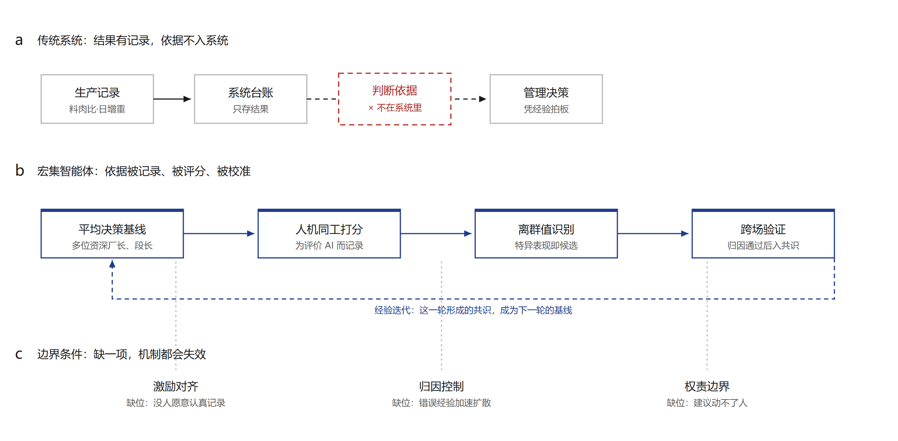

# 决策蒸馏与组织学习：宏集智能体在养殖场成本管控中的作用机制与边界条件

摘要：养殖场成本管控依赖料肉比、日增重、批次成本、死淘率等指标。这些指标背后的判断依据，往往只存在于资深厂长、段长的经验中，难以被数字化系统承接。数字化系统本身不会自动改善成本管控。它的效果取决于数据质量、经验判断能否被系统承接以及组织管理机制是否配套。本文以“决策蒸馏”视角分析宏集智能体的机制设计。机制以多位资深厂长、段长的平均决策偏向作为AI的初始学习基线。初期人机同工，由资深人员对AI学习结果打分校准。偏离平均值的特异数据作为候选更优解，经归因控制后跨场验证、纳入共识。该机制有两个层面的价值。其一，把数据质量提升从“要求一线自觉”转化为“评价AI的刚需”，在激励结构上回应数据治理难题。其二，以“平均基线保稳健、离群验证促演化”的设计，使组织经验从静态蒸馏走向动态演化。机制成立依赖三类边界条件。归因控制是前提，激励对齐是动力，权责边界决定能否落地。缺少任何一项，机制都会失效。归因控制缺位，错误经验会被加速扩散。激励对齐缺位，打分退化为礼貌性表态。权责边界缺位，AI只能提出建议而无法驱动执行。

关键词：决策蒸馏；组织学习；成本管控；宏集智能体；边界条件

## 一、问题背景（现状数据）：系统上线与成本改善之间的落差

养殖场成本管控的核心指标通常包括料肉比、日增重、批次成本和死淘率。这些指标看似清晰，背后却是一条完整的核算链条。饲料、兽药、人工、折旧等投入按批次归集，再分摊为单位成本。数字化系统（ERP、生产管理软件、物联网平台）在规模场的应用已由政策持续推动[1]。其成本红利也有系统综述与实证研究给出量化支持[2-5]。从产业面看，规模化的推进速度不慢。2024年全国生猪养殖规模化率预计超过70%（年出栏500头以上规模养殖场口径），比上年提升约2个百分点[6]。成本结构上，饲料占生猪养殖总成本的60%–70%，这是行业机构口径[7]。料肉比每变动一点，都会直接落在批次成本上。但系统上线与成本改善之间，并没有自动的联系。

现实中的落差集中表现为“数据录入靠人、决策还靠经验”。一线人员嫌录入麻烦，漏记错记难以避免。批次与栏舍划分不规范，数据归集口径混乱。系统里有了数据，管理者“不会看”或“看了也不信”，最终仍靠厂长、段长的经验判断。系统与硬件分开采购，同一条线上的数据又散在几处。可见数字化系统不会因为“上线”就自动带来精细化管理。系统本身不产生判断，只是把采集到的数据汇集起来供人使用。数据准，它让人看得更清。数据不准，它把人引得更偏。数据质量因此决定系统价值。录入不准、口径不一，算出来的成本只会误导决策。

本文的关注点由此从泛泛的“数字化系统”，收窄到“经验决策与数据系统之间的落差”。资深厂长、段长的判断力很难被传统系统承接。而一旦把这部分判断力“蒸馏”为智能体，数字化管理系统在成本管控中的角色也会跟着改变。分析对象是一家把多个养殖场统合经营的公司所推行的“宏集智能体”，并讨论其机制设计、潜在价值与成立条件。

需要说明的是，“统合经营的公司”与“宏集智能体”都是本文为分析机制而构建的设定，并非已投放市场的既有产品。文中引用的企业实践（中粮家佳康、正大集团、数影科技）均来自公开报道，仅用于对照说明现有实践与机制设计之间的差距。

## 二、原因与技术机理：经验判断无法进入系统

在成本核算链条上，数字化系统的价值在于把投入、批次归集和单位成本连接起来，使不同批次可比、异常可发现。但传统系统主要记录“结果”，很少记录“判断依据”。资深厂长看到料肉比偏高，可能凭经验判断是环控问题、饲料问题还是猪群健康问题。这种判断依赖大量隐性知识，难以直接写入ERP字段。系统能呈现数据，却不能承接“看数据的人如何想”。结果是数据在系统里，判断在人脑里，二者之间没有可以对照的记录。

“决策蒸馏”想把这二者对上。它把资深人员的经验与思维逻辑拆解为可计算特征与规则，使只能意会的判断变成能算、能评的做法。产业实践已有单点蒸馏样本。讯飞和光科技在中粮家佳康吉林长岭基地，把老兽医“听咳嗽知健康”的判断拆解为咳嗽频次、声纹频谱、活动量等可计算特征。据其公开材料，声纹模型使疫病预警提前2至3天[8]。但单点蒸馏有明确局限。单一厂长的经验带有个人偏差。经验一旦固化，又可能跟不上品种、饲料、行情和疫病条件的变化。只蒸馏某一个人的经验因此并不够稳健。更稳健的做法，是把多个场、多位资深员工的判断一并纳入，并保留共识演化的机制。这正是宏集智能体机制设计的出发点。

学术研究同样没有给出完整答案。三条线索各有推进，却都止步于同一个问题。

一是经验蒸馏与“智能体在环”（agent-in-the-loop）研究。该脉络已经系统梳理了把专家知识持续蒸馏进AI模型的流程[9]，也提出了“一次收集经验、离线固化权重”的技术路径[10]。但它默认专家意见可以聚合，没有为专家之间的分歧预留处理机制。

二是群体决策研究。它早已警告，把冲突性判断简单平均会抹去少数决策者掌握的尾部信息，群体中最优的个体往往优于群体平均[11]。不过这一警告停留在判断聚合的统计层面，没有进入蒸馏的流程设计。离群判断怎样被验证、何时纳入、何时排除，仍无机制可循。

三是畜牧数字化研究。综述量化了数字技术的成本红利[2-3]，也指出了数据质量与互操作性的结构性障碍[12]。但它没有把“人的经验如何被系统承接”当作一个设计问题。

三组文献都缺同一件事：怎样把多位专家的分歧组织起来、校准成可用的判断。本文的做法是用“平均基线→离群验证→归因控制”的机制设计，把群体决策的统计警告接入经验蒸馏的流程框架，并以畜牧场景的归因困难作为约束条件。

## 三、现存难点：分歧、归因与激励

难点集中在三处：多位资深人员的分歧难以聚合，归因控制难以成立，激励与权责难以对齐。

既然最好的做法往往出在少数人身上，一个自然的想法是直接以成绩最好的厂长为模板，不从平均值起步。这里的风险是归因谬误。某位厂长料肉比明显偏低，可能源于管理方法，也可能源于品种、栏舍、气候等条件优势。在无法区分“方法差异”与“条件差异”之前直接蒸馏最优个体，等于把不可归因的运气当成可复制的知识。更稳妥的做法是一头用平均基线稳住起点，一头用归因控制后的离群验证保留对更优做法的探索。这与组织学习理论中探索与利用的平衡逻辑一致[13]。只有利用而无探索，组织会收敛于平庸。只有探索而无利用，组织又无从积累。宏集智能体的机制设计，就是把这两件事排进同一套流程。

另外两类难点不在系统之内。

宏集智能体能否从“建议层”走向“执行层”，取决于若干系统之外的条件。这里只指出这些条件的必要性，不替企业设计方案。

一，归因控制。规范批次与栏舍编码、统一数据口径，是为了数据能归集，也是为了让AI能区分“方法差异”与“条件差异”。畜牧数字化研究已指出，不同养殖场因环境与品种差异形成的数据口径差异，以及系统间互操作性不足，是限制数字化效果的结构性障碍[12]。如果系统分不清“A厂长方法好”和“A厂条件好”，离群值同步就会把错的方法更快地传出去。因此“先规范管理、再上系统”在决策蒸馏场景下有了更具体的含义。规范管理是为了让离群值成为可验证的假设，而不是无法解释的异常。

二，激励对齐。如果某位厂长掌握独门方法，贡献出来同步给所有人，他的相对优势就会消失。理性选择可能是藏私，或者故意把别人的好方法打低分。所以“离群值同步验证”必须配上让“分享好方法”与“个人收益正相关”的激励设计。激励怎么定、由谁裁决，属于公司层面的组织决策。本文不越位设计，只指出方向。核算对象不应是个人成本排名，那会诱导藏私与数据表演。它应是他贡献了多少经过跨场验证、可归因、可复制的有效方法。集体智慧研究为此提供了实证佐证。当个体只因自己答案的准确性受奖时，人们反而更容易向群体均值收敛，牺牲判断多样性。当奖励与集体表现挂钩时，多样性与群体智慧才得以保持[14]。社会影响研究同样发现，向群体均值从众会系统性削弱群体智慧[15]。若打分者的收益只取决于个人相对排名，“离群值同步验证”最终只会产出表态，而不是知识。需要限定的是，这类判定只作流程门槛，不计入个人考核。否则表演会从“打分”转移到“写材料”。

三，权责边界。从“人机同工”到“真正的AI数字管理”，技术并不是难点。难点在信任和责任：谁先信，谁担责。合理的路径是渐进式移交。初期把AI的决策范围限定在低风险、高频次场景，随着准确率被结果数据验证，再逐步扩大。如果AI基于“平均经验”做出的决策在新疫情或新行情下失效，一线就会陷入遵从还是违背的两难。遵从造成的损失该由谁承担，也没有答案。这两个问题不回答，“真正的AI数字管理”就只是一个提出建议的系统，而不是能替人拿主意的系统。

## 四、对策建议：宏集智能体的机制设计

宏集智能体的设定是：一家公司把多个养殖场统合起来经营，多位资深厂长、段长持续跟踪学习行为标准，以他们的平均决策偏向为基准。初期实行“人机同工”，由资深人员对AI的学习结果打分并评价调整，之后逐步过渡为真正的AI数字管理。机制可以拆成三层来看，传统系统与宏集智能体的对比、机制流程及边界条件见图 1。

图1  传统数字化系统与宏集智能体的对比及其边界条件

产业界已有相近的构想。正大集团与零一万物合资的万蜂智能提出“AI场长”，把场长对环境、饲喂、鸡群状态的判断沉淀到智能体，“让一个场长管好100个场”，并以L1—L5分级规划成熟度[16]。它没有回答的正是前述问题。多位场长的判断怎样聚合、分歧怎样校准，公开资料没有交代。

第一，平均决策偏向是起点，不是上限。多位资深人员的平均判断可以避免单一厂长的个人偏差，为AI提供稳健的初始学习目标。群体决策研究也表明，等权平均在专家判断聚合中通常是稳健方法[11]。但平均意味着向中间收敛。成本管控最好的做法，常常出在偏离平均值的那几个人身上。某位厂长料肉比控制得特别好，其判断可能偏离平均，却恰恰是对的。AI需要同时接受“像不像厂长”的主观评价和“结果好不好”的客观结果校准。否则训练出来的AI只会让厂长觉得“像自己”，而不会让成本真的下降。就此而言，第一层机制给的是稳健性。它让AI的起点站在群体共识上，而不是某一个人的偏好上。

第二，人机同工与人类打分，倒逼数据规范。这一层的关键是改变了数据质量提升的激励结构。厂长、段长要给AI的学习结果打分并评价调整，就必须认真看数据、认真记录决策依据。不记录，就无法判断AI的对错。过去靠“加强培训、提高认识”解决不了的一线录入问题，在这里变成了“教AI”的刚需。让人类为了评价AI而认真对待数据，比要求一线自觉更有效。当然，打分不能只是主观偏好，必须与执行后的实际成本数据回溯校准。否则AI学到的只是人类现有认知的复制，而不是对人类盲区的发现。该环节可以由一个只判不说的判定模型分担一部分。它比对“评分”与“所附依据”是否对得上，对不上的退回重写，对得上的放行。它不判断结论对错，也不替人归因，只把材料不齐的打分挡在流程之外[17]。此处借鉴其“低置信度即升级”的级联思想，用于流程门槛而非结论判断。该层的价值不在数据本身，而在于它给一线人员提供了一个认真记录的理由。

第三，离群值同步验证。平均值不再是一个固定的数字，而是每轮更新的一版参照。偏离平均值的厂长特异数据，不宜简单当作噪音平均掉。它应视为AI识别出的“候选更优解”，同步给所有测试厂长验证。这样，偏离平均值的数据不再被抹掉，而成为下一轮验证的候选。

不过，离群验证要成立，还必须先补上归因控制。某位厂长的料肉比明显偏低，可能是因为方法更好，也可能是因为品种、栏舍、地域气候等条件更优。AI同步的不应是“结论”，而应是“假设＋证据＋适用条件”。例如“A场在品种X、环控Y条件下采用Z策略，使料肉比降低，建议在类似条件的场试点验证”。厂长们要评价的是“在我场条件下，这个归因是否成立”。至于“这个方法听起来好不好”，不构成评价。没有归因控制的经验扩散，比不扩散更危险。识别得准，好方法会很快传开。识别不准，错的方法也会同样快地传开。

产业实践同样如此。数影科技“FPF 未来猪场”公布的企业口径数据显示，其服务的 25 万头母猪体系客户综合成本比原体系低 0.4 元/斤。“母猪养殖在线”使企业管理效率提升 30% 以上，中小规模场部分案例每头母猪年增收超 4000 元[18]。但上述实践均未涉及多厂长分歧的校准与离群值处理。

验证通过的离群答案不应只被平均回共识。平均会抹掉它成立的条件。更妥当的是双轨沉淀。一条更新基线，供新手参照。另一条以“条件＋做法＋结果”的形式存入可检索的案例库，供条件相似的场调取。这类库的作用类似文献检索系统。它不给出唯一正解，只交代有哪些答案、由谁在什么条件下给出、被谁复用后是否仍然成立。但要警惕，把复用次数当作正确性是一种误读。社会影响研究已经表明，向群体选择靠拢会系统性削弱判断质量[15]。因此这个库只能提供先例，不能提供结论。

就此而言，宏集智能体的作用不止于把经验固化成模型，它还让组织经验持续更新。它加快的是经验更新的速度。速度快不等于方向对，前提是归因准确、激励对齐。

该机制能否成立，取决于上一章列出的三项条件。

## 五、个人判断

本文的核心判断是，数字化系统本身不会自动改善成本管控。它的效果取决于三件事：数据质量、经验判断能否被系统承接、组织管理机制是否配套。宏集智能体的意义不在于它蒸馏了多少位厂长的经验。它的意义在于“人机同工＋打分调整＋离群值验证”这套机制。这套机制把数据质量提升从“要求一线自觉”变成“评价AI的刚需”，组织经验从静态蒸馏走向动态演化。这三件事都要有条件保证。缺了归因控制，错误经验会扩散得更快。缺了激励对齐，它只换来礼貌性表态。缺了权责边界，它只是把“人不会看数据”换成了“智能体会看但指挥不动人”。

所以，数字化只能让“已经想清楚的管理”更快、更准，不能替人想清楚。养殖场在引入宏集智能体之前，仍要先回答几个问题：管什么、数据从哪来、离群值如何归因、分享如何激励、决策失误谁负责。这些都超出系统的范围，却决定系统能否真正参与成本管控。

对新晋员工，没有个人经验，多位资深人员的平均判断正好是起跑线，能把成长中最耗时的摸索阶段压缩掉。对资深员工，他们的价值恰恰在偏离平均的尾部。AI 的作用是把个人判断与一群人的判断放在一起，让离群值被看见、被验证。再往上一层，资深员工查的是案例库里的先例，而不是被 AI 指导。这与机制的两层是同构的。平均基线对新晋员工是教材，对资深员工是参照。

两条约束必须写明。其一，新晋员工的路径不能止于平均。若打分与晋升只奖励“像厂长”，新晋员工会长成又一个平均厂长，这正是第一层机制要防的讨好倾向。其二，“辅助”不等于“背书”。一旦资深员工不再看数据、只签结论，人机同工就退化为责任空转。辅助的正当形式是给出可核对的第二意见，而不是替人下结论。

宏集智能体不改变谁做判断，只改变判断之前能看到多少证据。它最终是辅导者还是替代者，取决于企业是否愿意把“教 AI 不会被替代”变成可置信的承诺。技术本身并不决定这件事。这属于公司层面的制度选择，本文不越位设计。

### 研究局限

本文属于机制设计层面的理论分析。宏集智能体是本文构建的机制模型，所提框架未经实地试点检验。其有效性有待在真实组织的归因控制与激励设计中观察和修正。不同品种、不同规模与数字化基础的养殖场，机制各环节的适用性也需分别讨论。此外，平均基线与离群验证之间的权重如何随组织成熟度调整，此处只给出定性判断，定量刻画留待后续研究。角色定位所牵涉的分配问题，此处只给出原则性判断，未做制度设计。

## 参考文献

[1] 农业农村部, 中央网络安全和信息化委员会办公室. 数字农业农村发展规划（2019—2025年）[EB/OL]. (2020-01-20)[2026-10-20]. https://www.moa.gov.cn/govpublic/FZJHS/202001/t20200120_6336316.htm.

[2] PAPADOPOULOS G, PAPANTONATOU M Z, UYAR H, et al. Economic and environmental benefits of digital agricultural technological solutions in livestock farming: a review[J]. Smart Agricultural Technology, 2025, 10: 100783.

[3] DAO S D, GOSTAR A K, TENNAKOON R, et al. Modernizing livestock operations: smart feedlot technologies and their impact[J]. Animals, 2026, 16(8): 1244.

[4] 靖环宇. 数字化转型对中小规模奶牛养殖场生产成本影响研究：以华盛奶牛养殖专业合作社为例[D]. 泰安: 山东农业大学, 2024.

[5] 谢东阳. 生猪养殖MY公司智能化养殖价值链成本管优化研究[D]. 杨凌: 西北农林科技大学, 2023. DOI: 10.27409/d.cnki.gxbnu.2023.002796.

[6] 农视网. 2024年农业农村发展成就[EB/OL]. (2024-12-25)[2026-11-07]. https://www.ntv.cn/content/1/392/991392652.html.

[7] 上海钢联（Mysteel农产品）. 2026年5月猪市：财报亏、成本高，企业还能支撑多久？[EB/OL]. (2026-05-19)[2026-10-20]. https://www.caaa.cn/html/fw/market/zhu/2026/0519/23756.html.

[8] 讯飞和光打造AI“老兽医” 推动养猪业迈入智能阶段[N/OL]. 科技日报, 2026-04-29[2026-11-07]. https://www.stdaily.com/web/gdxw/2026-04/29/content_510139.html.

[9] GAO J, ZHANG Y, CHEN Y, et al. Agent-in-the-loop to distill expert knowledge into artificial intelligence models: a survey[J]. Artificial Intelligence Review, 2025, 58(9): 1-55.

[10] GOU C, TU H, FANG Y, et al. Sample-efficient learning from agent experience[EB/OL]. (2026)[2026-10-20]. https://arxiv.org/abs/2607.21051. [预印本]

[11] MANNES A E, SOLL J B, LARRICK R P. The wisdom of select crowds[J]. Journal of Personality and Social Psychology, 2014, 107(2): 276-299.

[12] BAHLO C, DAHLHAUS P, THOMPSON H, et al. The role of interoperable data standards in precision livestock farming in extensive livestock systems: a review[J]. Computers and Electronics in Agriculture, 2019, 156: 459-466. DOI: 10.1016/j.compag.2018.12.007.

[13] MARCH J G. Exploration and exploitation in organizational learning[J]. Organization Science, 1991, 2(1): 71-87.

[14] BAZAZI S, VON ZIMMERMANN J, BAHRAMI B, et al. Self-serving incentives impair collective decisions by increasing conformity[J]. PLoS ONE, 2019, 14(11): e0224725.

[15] LORENZ J, RAUHUT H, SCHWEITZER F, et al. How social influence can undermine the wisdom of crowd effect[J]. Proceedings of the National Academy of Sciences, 2011, 108(22): 9020-9025.

[16] 从ChatGPT到ChickenGPT？零一万物和正大集团把AI带进鸡舍[EB/OL]. [2026-10-20]. https://www.zgswcn.com/news.html?aid=345926.

[17] LI Y, MIAO Y, KRISHNAN R, et al. JEV-as-a-judge: accept when confident, escalate when unsure[EB/OL]. (2026)[2026-10-20]. https://arxiv.org/abs/2609.26550. [预印本]

[18] 全球农食产业领袖在“农业达沃斯”论坛共话AI+养猪新成果[EB/OL]. (2025-10-17)[2026-10-20]. https://www.farmer.com.cn/2025/10/17/991002119.html.
